 

---

## 我是谁

懂**跨境贸易与供应链**业务的全栈工程师，TypeScript / Python 双栈。2024 年至今独立完成 **60+ 个项目（含 33 个企业级私有项目与 27+ 个公开开源仓库）**。

我做的事可以收拢成一句话：**把散落在一线的知识、数据、工具与 AI 能力，整合成一套能跑起来、能复用的系统。**

> **人提供方向与判断，AI 提供执行与可能性。** 我的差异化不是单一技术栈，而是**整合**——下面三层，就是这句话的展开。

---

## 一 · 知识整合　把业务经验变成可计算、可复用的资产

我在外贸一线积累的报价规则、库存与订单逻辑、配件编码体系、报关流程、客户分层方法，被系统性地从「人脑里的经验」整理成**数据模型、计算引擎、文档与 AI Skill**。

- **报价一致性系统**　把全部报价公式从云端文档搬进本地计算引擎复算，打通报价 / 库存 / 订单口径；订单自动转换为商业发票、装箱单、报关单。
- **多品牌配件数据逆向与目录结构化**　逆向解析 Crown（PSRT5 / SQL Server）、Jungheinrich（Jeti）、Linde（Service Guide）的配件数据，统一为可扩展的多品牌检索目录；配套开源了矢量配件手册转带图表格工具 [**parts-catalog-pdf-to-xlsx**](https://github.com/Jim-purch/parts-catalog-pdf-to-xlsx)。
- **工作流与销售知识 Skill 化**　把客户分级、深度背调、话术起草、工作复盘与心理陪伴封装为标准化 AI Skill（公开示例：[**accio-work-output.skill**](https://github.com/Jim-purch/accio-work-output.skill)、[**soul-mirror-with-other.skill**](https://github.com/Jim-purch/soul-mirror-with-other.skill)、[**companion.skill**](https://github.com/Jim-purch/companion.skill)）。

`Python` `FastAPI` `SQLite` `Next.js` `AirScript` `Agent Skill`

---

## 二 · 资源整合　把分散的数据源、工具与 AI 能力聚合成统一入口

把散落在阿里国际站（ICBU）、WhatsApp、邮件、飞书、WPS 表格、Google Sheets、PDF 与图片里的数据，以及 Webhook、MCP、LLM、TTS 等能力，收拢成可查询、可调用的入口。

- **外贸销售 AI 中台**　多源实时采集客户会话与画像，本地增量归档、跨销售按手机号去重形成统一「客户公海」，再由 AI 完成翻译、分级、背调与跟进提醒——团队共享同一份客户认知。
  `ICBU` `WhatsApp` `邮件` `飞书` `SQLite / FTS5` `Chrome 扩展` `Hub + Agent`
- **jim-wps-mcp-server**　基于 MCP 协议打通 AI 与企业 WPS 云表格，支持 `stdio` 与 `HTTP/SSE` 双传输；已发布 npm，`npx` 一键运行。
  🔗 源码：[github.com/Jim-purch/jim-wps-mcp-server](https://github.com/Jim-purch/jim-wps-mcp-server) · 📖 [架构与接入指南](https://jim-resume.vercel.app/blog/wps-mcp-server-guide)
- **云表格快速查找 SaaS**　集中管理 WPS / Google Sheets 脚本令牌，跨表多条件搜索、Token 权限分享、一键生成 MCP 配置。
  🔗 源码：[github.com/Jim-purch/websearch-wps-webhook](https://github.com/Jim-purch/websearch-wps-webhook) · 📖 [全栈构建手记](https://jim-resume.vercel.app/blog/cloud-sheet-saas-guide)
- **sheets2kdocs 跨云表格定时同步**　自托管 FastAPI 连接器，将 Google Sheets 定时增量同步（Upsert / Replace）至金山文档（WPS）智能表格，自带管理后台与字段映射。
  🔗 源码：[github.com/Jim-purch/sheets2kdocs](https://github.com/Jim-purch/sheets2kdocs)
- **图像与文档批处理流水线**　背景替换、条码识别命名（[**bgremove-zbar-rename**](https://github.com/Jim-purch/bgremove-zbar-rename)）、OCR 采集（[**image-ocr-csv**](https://github.com/Jim-purch/image-ocr-csv)）、矢量 PDF 转高清 SVG/PNG（[**pdf-to-svg-png**](https://github.com/Jim-purch/pdf-to-svg-png)），把人工重复操作整合成一键管线。

---

## 三 · 能力整合　一个人跑通从业务建模到上线运维的完整链路

从需求调研、数据建模、API、前端交互，到 Docker / Caddy / FRP 部署与监控，独立闭环，不依赖外部平台。

- **海量配件数据库系统**　配件 2000 万+ 条、转换码 2900 万+ 条，数据库 30+ GB。设计 PostgreSQL 主从 + 读写分离 + Redis 多级缓存 + Elasticsearch 全文检索架构；支持 **1000+ 并发**，查询提速 **10–50 倍**，平均响应 **< 100ms**，相关人力由 **6 人降至 2 人**。
  📖 [千万级检索架构演进实录](https://jim-resume.vercel.app/blog/parts-database-architecture) · `Flask` `PostgreSQL` `Redis` `Elasticsearch` `Docker` `PyQt5`
- **自托管基础设施**　Windows 上的 Caddy / FRP 站点与隧道管理面板、统一邮箱验证码鉴权与跨子域 SSO、对象存储鉴权微服务（[**qiniuyun-upload-auth**](https://github.com/Jim-purch/qiniuyun-upload-auth)）、文件搜索安全代理，让整套系统可私有化、可远程运维。
  `FastAPI` `Caddy` `FRP` `Nginx`
- **全栈与原生创新产品**　从心理投射多模态应用、macOS 免驱动内录实时转写工具，到太空探索放置游戏与浏览器效率插件，独立完成设计、开发与部署。

---

## 精选公开开源项目

| 项目仓库 | 核心解决的问题 | 技术栈与延伸阅读 |
| :--- | :--- | :--- |
| [**jim-wps-mcp-server**](https://github.com/Jim-purch/jim-wps-mcp-server) | 让 Claude / Cursor 等智能体直连企业 WPS 云表格（已发布 npm） | TypeScript · MCP · [接入指南](https://jim-resume.vercel.app/blog/wps-mcp-server-guide) |
| [**websearch-wps-webhook**](https://github.com/Jim-purch/websearch-wps-webhook) | 企业云表格令牌管理、跨表快速检索与 MCP 配置生成平台 | Next.js 16 · Supabase · [架构手记](https://jim-resume.vercel.app/blog/cloud-sheet-saas-guide) |
| [**sheets2kdocs**](https://github.com/Jim-purch/sheets2kdocs) | Google Sheets → 金山文档（WPS）智能表格自托管定时同步服务 | Python · FastAPI · Admin UI |
| [**OH-MindMirror**](https://github.com/Jim-purch/OH-MindMirror) | 基于 OH 卡牌投射原理与 Gemini 2.0 的 AI 深度自我探索工具 | React · Gemini API · [开发手记](https://jim-resume.vercel.app/blog/oh-mindmirror-intro) |
| [**mac-voice-to-text**](https://github.com/Jim-purch/mac-voice-to-text) | macOS 免虚拟声卡系统内录 + 外录双通道实时语音转文字桌面工具 | Swift · ScreenCaptureKit · [实践指南](https://jim-resume.vercel.app/blog/mac-voice-to-text-guide) |
| [**telechat**](https://github.com/Jim-purch/telechat) | DeepSeek 深度推理 + MiniMax 高拟真语音合成双通道 Telegram 机器人 | Node.js · Docker · [部署指南](https://jim-resume.vercel.app/blog/telechat-voice-bot) |
| [**put-watermark-web**](https://github.com/Jim-purch/put-watermark-web) | 纯浏览器端本地批量图片加水印工具，零上传，15MB Docker 镜像私有化 | Vite · Canvas · Docker · [私有化手记](https://jim-resume.vercel.app/blog/batch-watermark-privacy-guide) |
| [**parts-catalog-pdf-to-xlsx**](https://github.com/Jim-purch/parts-catalog-pdf-to-xlsx) | 自动将矢量产品手册 PDF（含内嵌图片）结构化提取转换为 XLSX | Python · PDF 解析自动化 |
| [**bgremove-zbar-rename**](https://github.com/Jim-purch/bgremove-zbar-rename) | 移除产品拍摄杂乱背景、识别条码自动命名归档并批量合成新背景 | Python · 计算机视觉 · ZBar |
| [**soul-mirror-with-other.skill**](https://github.com/Jim-purch/soul-mirror-with-other.skill) | AI 引导的多人关系探索与非暴力沟通对话系统 | Agent Skill · Prompt Engineering |
| [**know-yourself-tools**](https://github.com/Jim-purch/know-yourself-tools) | 人工咨询 + AI 结合的自我认知与探索 Web 工具集 | React · TypeScript |
| [**quick-form-filling-chrome-plugin**](https://github.com/Jim-purch/quick-form-filling-chrome-plugin) | 快速批量填写固定网页表单输入框的 Chrome 扩展 | Chrome Extension · JavaScript |
| [**pdf-picture-extract-pc-tool**](https://github.com/Jim-purch/pdf-picture-extract-pc-tool) | 从标签 PDF 拖拽提取二维码图片的跨平台桌面工具 | Python · GitHub Actions |
| [**qq-music-local-web-control**](https://github.com/Jim-purch/qq-music-local-web-control) | 局域网浏览器远程协同控制办公室电脑 QQ 音乐 | Python · Playwright |

---

## 技术与工具

- **语言**　TypeScript, Python, JavaScript, Swift, SQL
- **前端**　React 19, Next.js 15/16, Vue 3, Vite, Tailwind CSS v4, Zustand
- **后端**　FastAPI, Flask, Node.js, Express, Socket.IO, RESTful / SSE
- **数据**　PostgreSQL, SQLite（`node:sqlite`）, Redis, Elasticsearch, Supabase (RLS), FTS5
- **AI**　MCP Protocol, Agent Skill, LLM 编排（Claude / DeepSeek / Gemini / 智谱 / Kimi / OpenAI 兼容端点）, MiniMax TTS, Whisper ASR
- **运维**　Docker / Compose, Nginx, Caddy, FRP, GitHub Actions, pm2, Vercel

---

## AI 如何进入我的流程

不是「用 AI 帮我写代码」，而是把 AI 工程化进交付链路：

1. **先文档后代码**　每个项目沉淀 `docs/`（调研、决策、部署、运维日志），需求模糊时先定方案；
2. **规范 + 工具化**　用项目规范文件 + 自定义 Skill + MCP Server 连接业务数据源，让 AI 在受控上下文里工作；
3. **人工把关**　AI 生成内容一律经代码审查、测试与部署验证，未经验证的数字与结论不写入交付物；
4. **一次解决，长期复用**　可复用的部分固化为 Skill、脚本管线或模板。

---

## 我在寻找什么

- **岗位方向**　AI 应用工程 / 全栈开发 / 企业数字化 / 技术负责人
- **合作方向**　AI 落地、MCP 生态集成、企业流程自动化、跨境贸易数字化系统
- 远程或线下均可，欢迎直接邮件联系。

 

📄 完整项目与经历详版：[Jim_Resume.md](./Jim_Resume.md)

